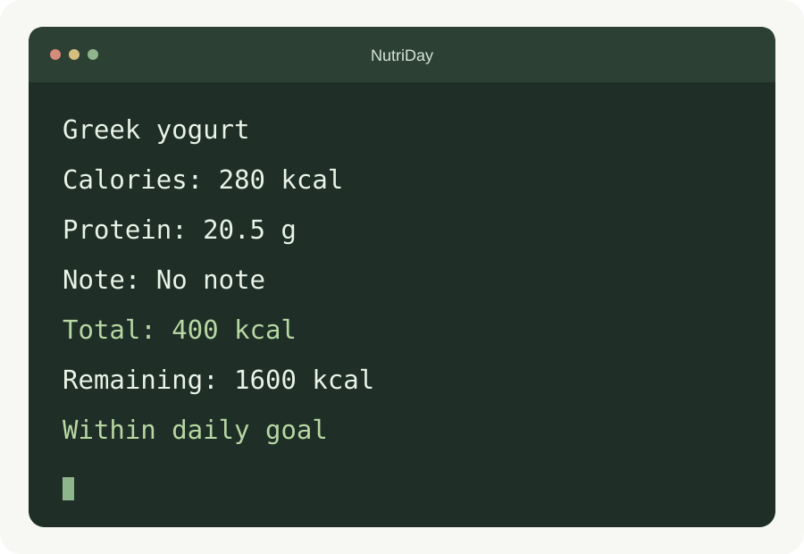
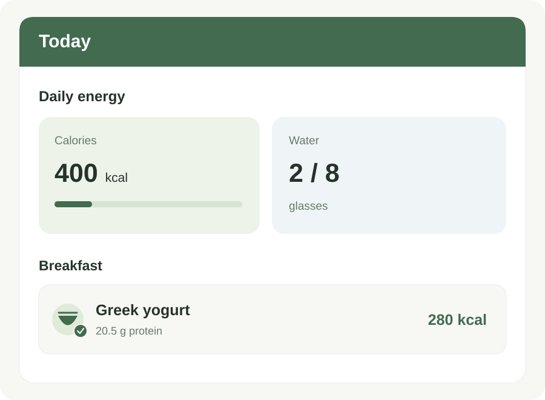
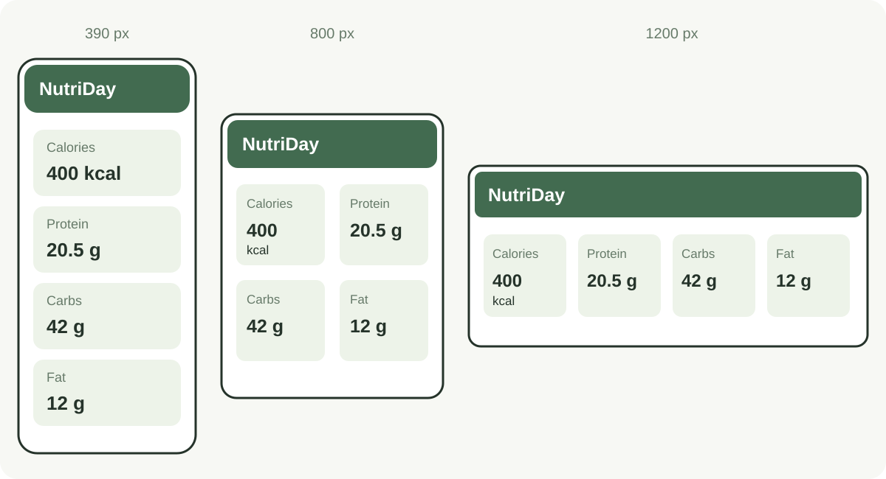
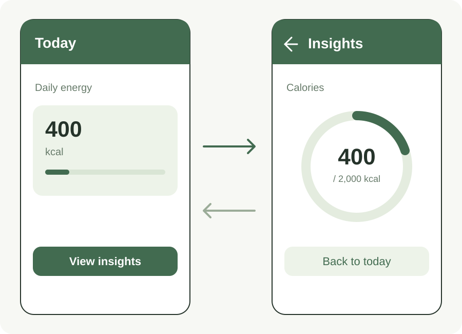
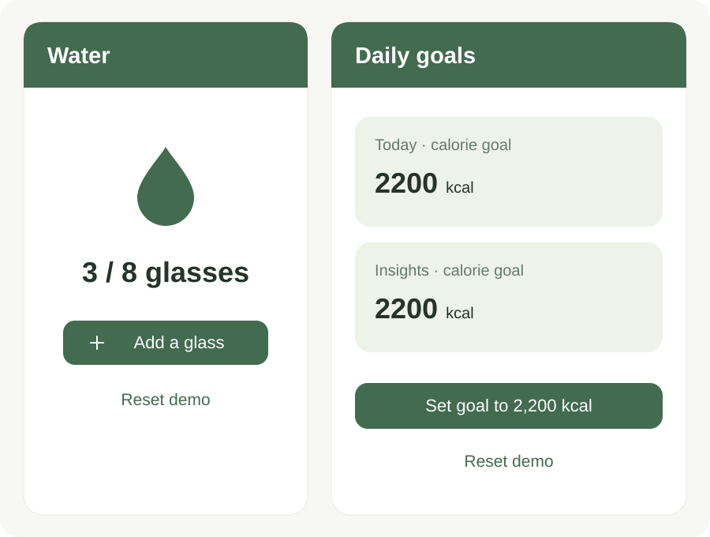
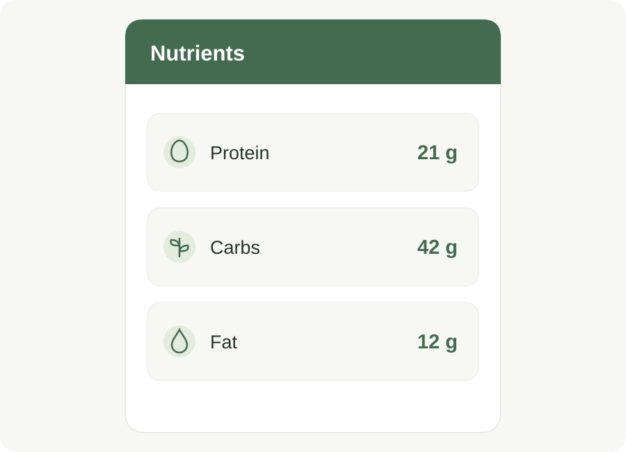
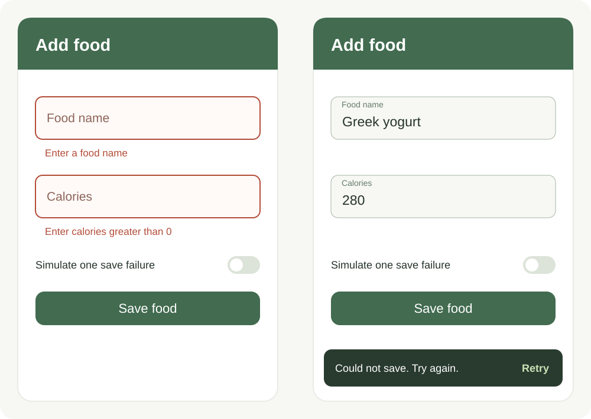
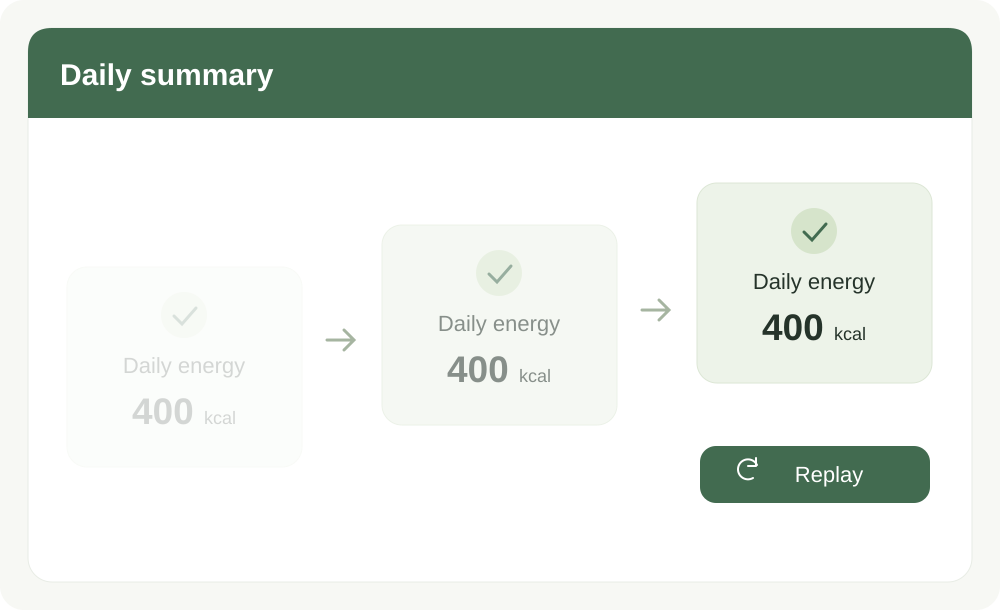

# NutriDay — Nutrient Tracker (Flutter)

## Abstract

NutriDay is a cross-platform nutrient tracker built with Flutter and Dart. It helps users record meals, track calories and macronutrients, log water, set daily goals, and review their nutrition in Insights. Food entries are grouped into breakfast, lunch, dinner, and snacks, with separate records for each date.

The application uses Flutter's Material interface and stores daily logs and goals locally with `shared_preferences`. The experiments below demonstrate Flutter concepts using NutriDay's food, hydration, and nutrient-goal examples.

## Experiments 1–8

The images show illustrative output for the matching runnable [experiment files](#experiment-files).

### Experiment 1 — Dart Basics



### Experiment 2 — Flutter Widgets and Layouts



### Experiment 3 — Responsive UI



### Experiment 4 — Navigation and Named Routes



### Experiment 5 — Stateful & Stateless Widgets + State Management



### Experiment 6 — Custom Widgets and Themes



### Experiment 7 — Forms, Validation and Error Handling



### Experiment 8 — Animations



## Experiment Files

```text
experiments/
├── 01_dart_basics.dart
├── 02_widgets_layouts.dart
├── 03_responsive_ui.dart
├── 04_navigation_named_routes.dart
├── 05_setstate_counter.dart
├── 05_state_management.dart
├── 06_custom_widgets_themes.dart
├── 07_forms_validation.dart
├── 08_animations.dart
├── experiment_theme.dart
└── nutrient_goals.dart
```

## Run the App or an Experiment

Install the Flutter SDK, then run these commands from the repository root:

```sh
flutter create --platforms=android,ios,web .
flutter pub get
flutter run -t lib/main.dart
```

Run Dart basics in the terminal:

```sh
dart run experiments/01_dart_basics.dart
```

Run a Flutter experiment by selecting its entry point:

```sh
flutter run -t experiments/02_widgets_layouts.dart
flutter run -t experiments/03_responsive_ui.dart
flutter run -t experiments/04_navigation_named_routes.dart
flutter run -t experiments/05_setstate_counter.dart
flutter run -t experiments/05_state_management.dart
flutter run -t experiments/06_custom_widgets_themes.dart
flutter run -t experiments/07_forms_validation.dart
flutter run -t experiments/08_animations.dart
```

The learning experiments are separate demonstrations. The main tracker remains in [`lib/main.dart`](lib/main.dart); its data is saved locally. See [Flutter and Dart Concepts](docs/FLUTTER_CONCEPTS.md) for the lesson mapping.
