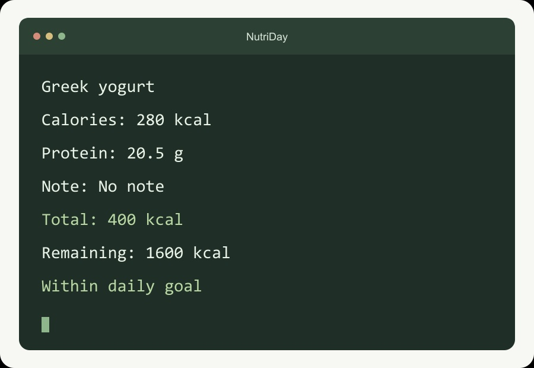
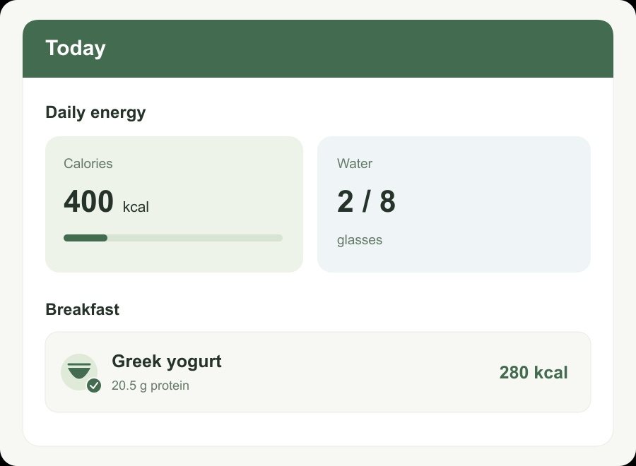
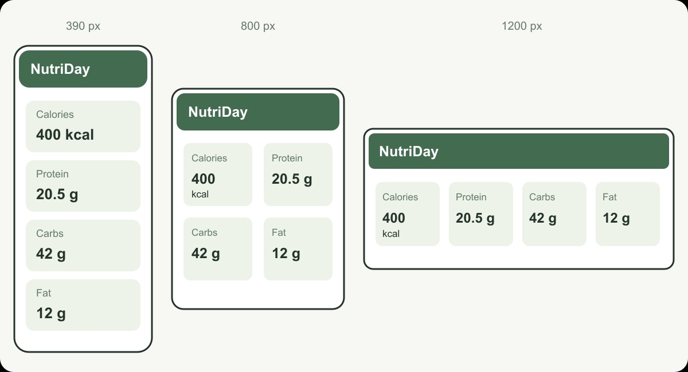
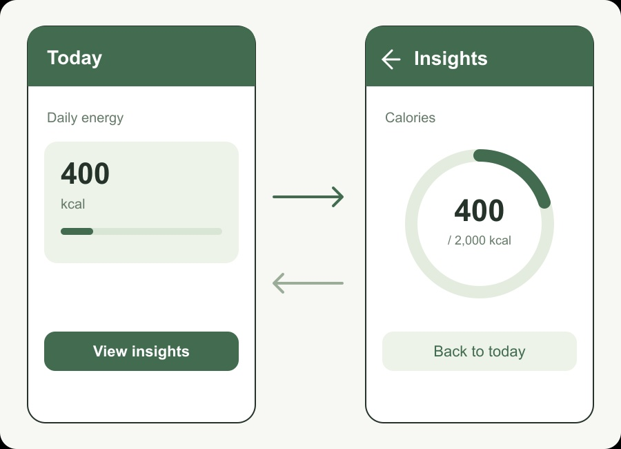
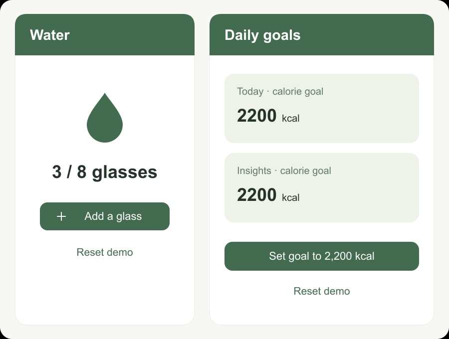
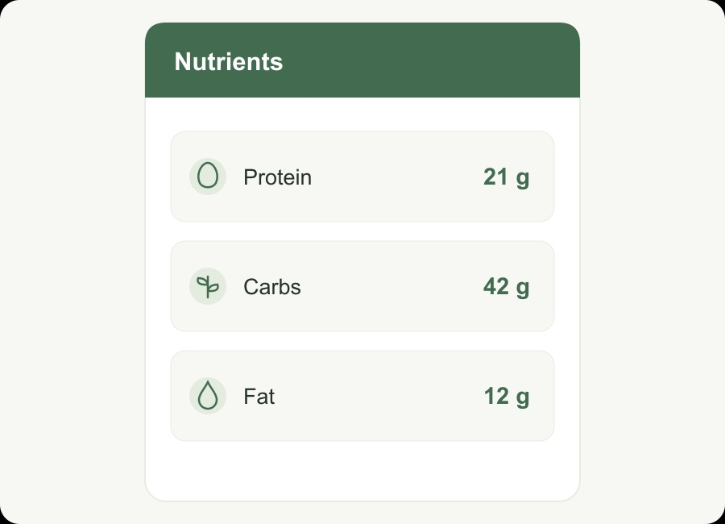
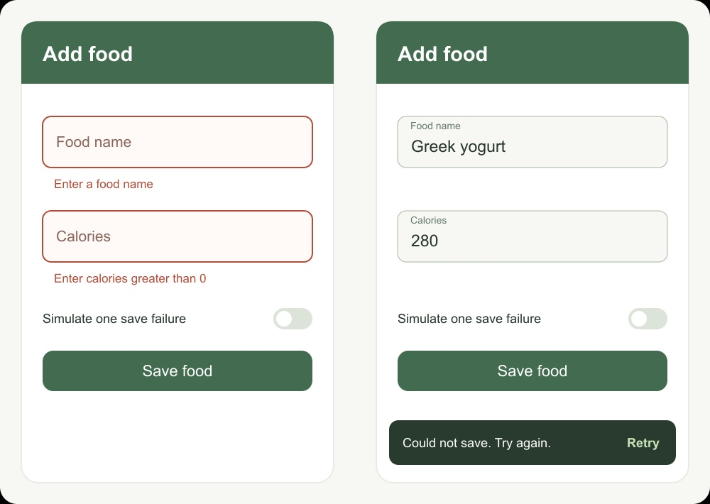
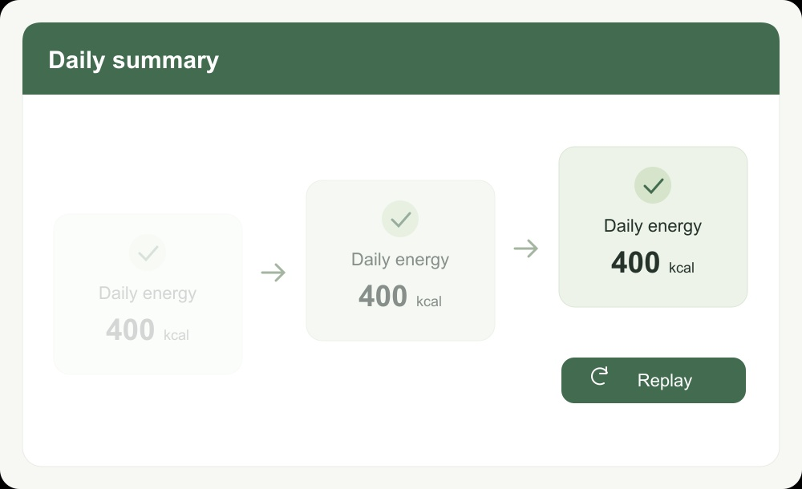

# NutriDay — Nutrient Tracker (Flutter)

## Abstract

NutriDay is a cross-platform nutrient tracker built with Flutter and Dart. It helps users record meals, track calories and macronutrients, log water, set daily goals, and review their nutrition in Insights. Food entries are grouped into breakfast, lunch, dinner, and snacks, with separate records for each date.

The application uses Flutter's Material interface and stores daily logs and goals locally with `shared_preferences`. The experiments below demonstrate Flutter concepts using NutriDay's food, hydration, and nutrient-goal examples.

## Experiments 1–8

The images show illustrative output for the matching runnable [experiment files](#experiment-files).

### Experiment 1 — Dart Basics

Dart is the programming language used to build Flutter applications. This experiment introduces variables, data types, arithmetic operations, string interpolation, conditional statements, and functions. `final` holds a value assigned once, `const` defines a compile-time constant, and a nullable type such as `String?` allows a value to be absent.

In the nutrient tracker example, Greek yogurt has **280 calories** and **20.5 g of protein**. The `addCalories` function adds another 120 calories to produce **400 calories**. The program also handles the missing note and checks the total against a 2,000-calorie goal, leaving **1,600 calories** remaining.

**Output:**



### Experiment 2 — Flutter Widgets and Layouts

Flutter builds an interface by combining widgets into a tree. `Row` places widgets horizontally, `Column` arranges them vertically, and `Stack` lets widgets overlap. `Expanded` shares the available width between children, while padding and spacing make the layout easier to read.

This experiment builds a NutriDay dashboard with calorie and water summary cards beside each other and a breakfast entry below them. A `Column` groups the content inside each summary card, and a `Stack` positions a check badge over the food icon. A `ListView` lets the dashboard scroll when space is limited.

**Output:**



### Experiment 3 — Responsive UI

A responsive interface adapts its layout to the available screen width. This experiment reads the width using `MediaQuery` and chooses how many columns the nutrient grid should display. The same information stays visible as its arrangement changes.

NutriDay shows calorie, protein, carbohydrate, and fat cards in **one column below 600 pixels**, **two columns from 600 to 999 pixels**, and **four columns at 1,000 pixels or wider**. The output compares compact, tablet, and desktop layouts using the same nutrient values.

**Output:**



### Experiment 4 — Navigation and Named Routes

Navigation allows users to move between screens. Named routes assign a path to each destination, and `MaterialApp` maps those paths to page widgets. `Navigator.pushNamed()` opens a screen on the navigation stack, while `Navigator.pop()` returns to the previous one.

In this experiment, `/` opens NutriDay's **Today** page and `/insights` opens **Insights**. Selecting **View insights** displays the day's 400 calories against a 2,000-calorie goal. The **Back to today** button returns to the dashboard.

**Output:**



### Experiment 5 — Stateful & Stateless Widgets + State Management

A `StatelessWidget` renders the inputs it receives without owning mutable state. A `StatefulWidget` holds values that can change during use; calling `setState()` schedules a rebuild so the interface reflects the change. When multiple widgets need the same changing value, a shared model can keep them synchronized.

This experiment includes two NutriDay demonstrations. The local water counter uses `setState()` to increase hydration from **2 to 3 glasses**. The shared-goal example uses **Provider**, `ChangeNotifier`, and `notifyListeners()` to update both the Today and Insights goal summaries from **2,000 to 2,200 calories**.

**Output:**



### Experiment 6 — Custom Widgets and Themes

Custom widgets package repeated interface elements into reusable components. Their parameters supply the content, while `ThemeData` provides consistent colors, typography, and component styling throughout an application. This keeps repeated elements easier to maintain.

The NutriDay example defines a reusable `NutrientTile` with a label, numeric value, and icon. The same widget displays protein, carbohydrates, and fat in themed cards. Values are formatted to whole grams, so **20.5 g of protein appears as 21 g**, alongside **42 g of carbohydrates** and **12 g of fat**.

**Output:**



### Experiment 7 — Forms, Validation and Error Handling

Forms collect user input and validate it before submission. This experiment uses `Form`, `GlobalKey<FormState>`, and `TextFormField` validators to require a food name and a finite calorie value greater than zero. Invalid fields display messages explaining what needs correcting.

The add-food demonstration also handles asynchronous save failures with `try`/`catch` and a `SnackBar`. Turning on **Simulate one save failure** makes the next valid submission fail deliberately. The entered Greek yogurt and 280 calories remain visible, and **Retry** attempts the demonstration save again. This example uses a simulated save rather than writing to the main meal log.

**Output:**



### Experiment 8 — Animations

Animations change visual properties over time to make interface transitions smoother. An `AnimationController` controls progress and duration, while a tween defines the starting and ending values. `FadeTransition` changes a widget's opacity, and `SlideTransition` changes its position.

In this NutriDay example, the **400-calorie daily summary** fades in while sliding upward into place over 800 milliseconds. The **Replay** button restarts the animation. The output illustrates the card's progression from a faint, lower position to its fully visible final position.

**Output:**



## Experiment Files

```text
experiments/
├── 01_dart_basics.dart
├── 02_widgets_layouts.dart
├── 03_responsive_ui.dart
├── 04_navigation_named_routes.dart
├── 05_setstate_counter.dart
├── 05_state_management.dart
├── 06_custom_widgets_themes.dart
├── 07_forms_validation.dart
├── 08_animations.dart
├── experiment_theme.dart
└── nutrient_goals.dart
```

## Run the App or an Experiment

Install the Flutter SDK, then run these commands from the repository root:

```sh
flutter create --platforms=android,ios,web .
flutter pub get
flutter run -t lib/main.dart
```

Run Dart basics in the terminal:

```sh
dart run experiments/01_dart_basics.dart
```

Run a Flutter experiment by selecting its entry point:

```sh
flutter run -t experiments/02_widgets_layouts.dart
flutter run -t experiments/03_responsive_ui.dart
flutter run -t experiments/04_navigation_named_routes.dart
flutter run -t experiments/05_setstate_counter.dart
flutter run -t experiments/05_state_management.dart
flutter run -t experiments/06_custom_widgets_themes.dart
flutter run -t experiments/07_forms_validation.dart
flutter run -t experiments/08_animations.dart
```

The learning experiments are separate demonstrations. The main tracker remains in [`lib/main.dart`](lib/main.dart); its data is saved locally. See [Flutter and Dart Concepts](docs/FLUTTER_CONCEPTS.md) for the lesson mapping.
